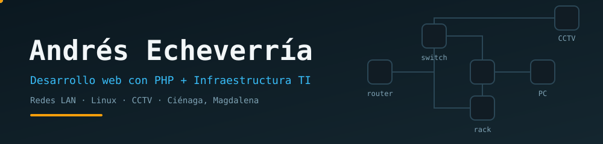

<a href="https://xlandreslx.github.io/XLANDRESLX/"><b>🌐 Ver mi portafolio web</b></a>

## 👨‍💻 Perfil

Profesional en Tecnología y Desarrollo de Software con sólida trayectoria en mantenimiento de infraestructura TI, redes estructuradas LAN y seguridad electrónica (CCTV). Especializado en soluciones web eficientes con **PHP**, administración de servidores **Linux** y automatización de procesos con **Inteligencia Artificial**. Con dominio de **Scrum**, aporto una visión integral que asegura la disponibilidad de la infraestructura y el rendimiento del software.

📍 Ciénaga - Magdalena, Colombia · 🎓 Ingeniería Informática, UNICARIBE

## 🚀 Sobre mí

- 💻 Desarrollo de software web (sistemas a medida) e infraestructura TI y soporte técnico.
- 🤖 Integro herramientas de IA para optimizar la lógica de programación y la gestión de bases de datos.
- 🛡️ Redes LAN, gabinetes rack, políticas de seguridad (GPO) y sistemas CCTV.

## 🛠️ Tecnologías

<b>🖥️ Infraestructura, redes y sistemas</b>

- **Sistemas operativos:** Linux (Debian, Linux Mint), Windows (administración, despliegue y GPO).
- **Redes:** cableado estructurado LAN, gabinetes rack, canalización física.
- **Soporte y hardware:** mantenimiento preventivo y correctivo, diagnóstico de fallas.
- **CCTV:** analógico HD, DVR/NVR Hikvision y Dahua, monitoreo remoto.

## 📂 Proyectos destacados

| | |
|---|---|
| **📅 Vanite — gestión de citas para estilismo** Automatiza agendas, clientes y servicios. PHP nativo, Bootstrap y JavaScript. | **🛒 POS e inventario — Distribuidora Reyes** Control de existencias, ventas y reportes, con apoyo de IA para la lógica y la base de datos. |

## 📊 Estadísticas

<picture>
  <source media="(prefers-color-scheme: dark)" srcset="assets/snake-dark.svg">
  
</picture>

## 📫 Contacto

⭐ ¡Gracias por visitar mi perfil! Siempre abierto a colaborar en proyectos de desarrollo web o infraestructura.

